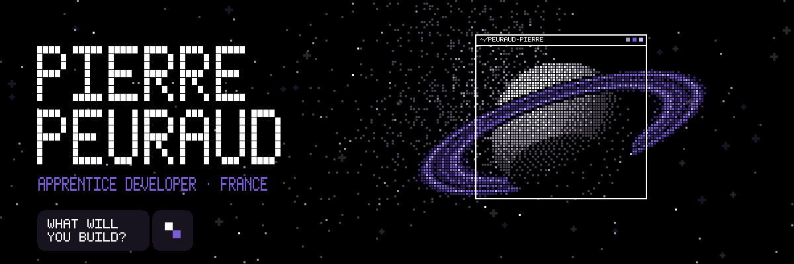
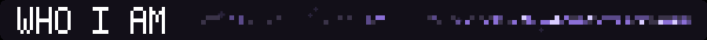
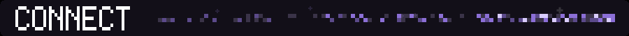
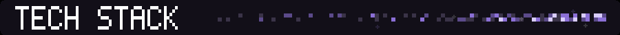
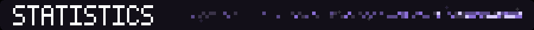
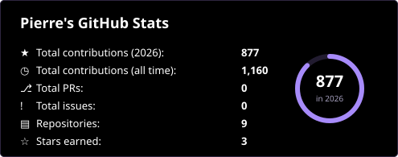
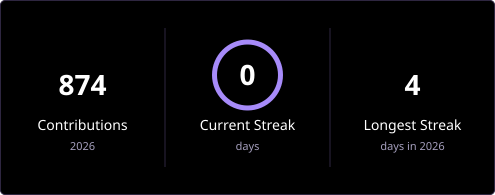
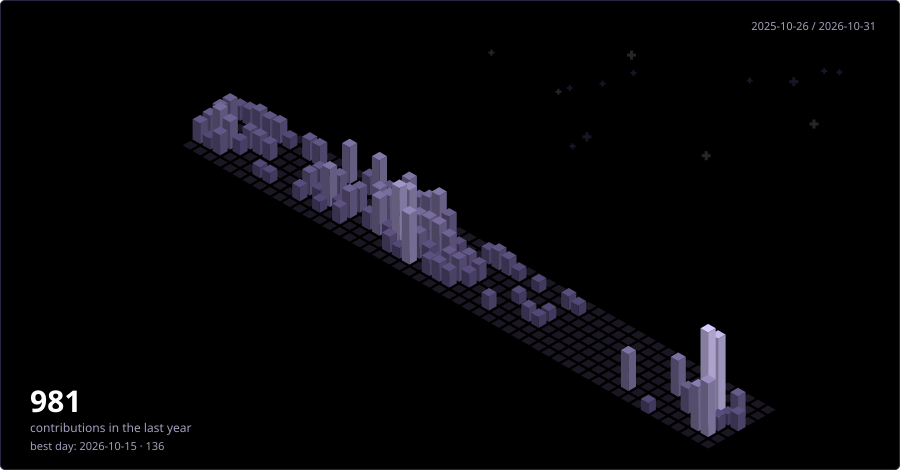

<div align="center">

<picture><source media="(prefers-color-scheme: dark)" srcset="assets/banner-dark.svg" /><source media="(prefers-color-scheme: light)" srcset="assets/banner-light.svg" /></picture>

</div>

<picture><source media="(prefers-color-scheme: dark)" srcset="assets/h-about-dark.svg" /><source media="(prefers-color-scheme: light)" srcset="assets/h-about-light.svg" /></picture>

<picture><source media="(prefers-color-scheme: dark)" srcset="assets/ascii-planet-dark.svg" /><source media="(prefers-color-scheme: light)" srcset="assets/ascii-planet-light.svg" /></picture>

```
~/peuraud-pierre $ whoami
```

Hello there! I'm **Pierre Peuraud**, an apprentice developer based in **France** 🇫🇷.

I explore different languages and technologies to strengthen my skills and build increasingly interesting projects — from low-level systems in **C** and **Rust** to web apps with **TypeScript** and **Vue**.

- 🎓 Young developer
- 🖥️ Currently learning server-side development
- 🌐 Building web apps with Vue & TypeScript
- 💻 Always looking for new projects

<br clear="right"/>

<picture><source media="(prefers-color-scheme: dark)" srcset="assets/h-connect-dark.svg" /><source media="(prefers-color-scheme: light)" srcset="assets/h-connect-light.svg" /></picture>

<div align="center">

[](https://github.com/Peuraud-Pierre)
[](https://portfolio-one-umber-51.vercel.app)

<!-- Ajoute tes liens ici, ex. :
[](https://www.linkedin.com/in/TON-PROFIL)
-->

</div>

<picture><source media="(prefers-color-scheme: dark)" srcset="assets/h-stack-dark.svg" /><source media="(prefers-color-scheme: light)" srcset="assets/h-stack-light.svg" /></picture>

<div align="center">

<picture><source media="(prefers-color-scheme: dark)" srcset="https://skillicons.dev/icons?i=c,rust,ts,js,vue,html,css,git,linux&theme=dark" /><source media="(prefers-color-scheme: light)" srcset="https://skillicons.dev/icons?i=c,rust,ts,js,vue,html,css,git,linux&theme=light" /></picture>

</div>

<picture><source media="(prefers-color-scheme: dark)" srcset="assets/h-stats-dark.svg" /><source media="(prefers-color-scheme: light)" srcset="assets/h-stats-light.svg" /></picture>

<div align="center">

<picture><source media="(prefers-color-scheme: dark)" srcset="assets/stats-card-dark.svg" /><source media="(prefers-color-scheme: light)" srcset="assets/stats-card-light.svg" /></picture> <picture><source media="(prefers-color-scheme: dark)" srcset="assets/stats-streak-dark.svg" /><source media="(prefers-color-scheme: light)" srcset="assets/stats-streak-light.svg" /></picture>

<br/><br/>

<picture><source media="(prefers-color-scheme: dark)" srcset="assets/stats-3d-dark.svg" /><source media="(prefers-color-scheme: light)" srcset="assets/stats-3d-light.svg" /></picture>

</div>
